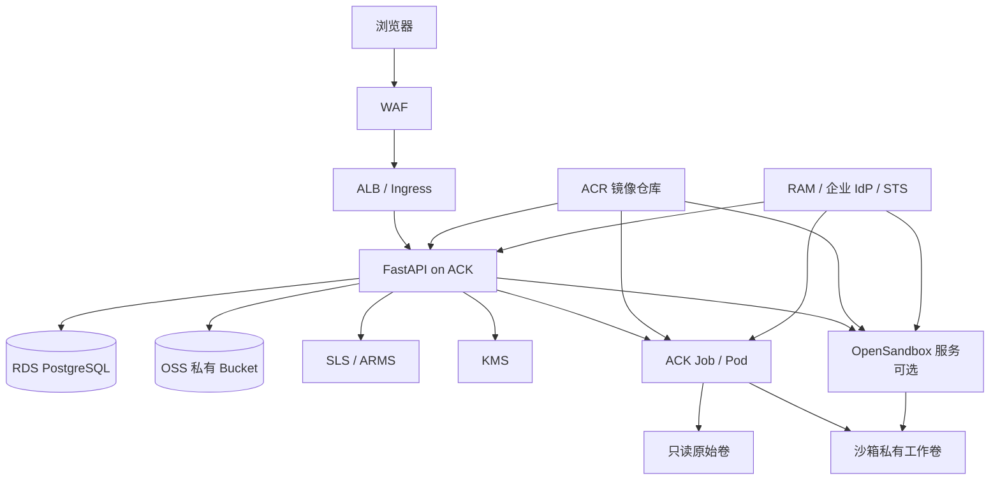

# 阿里云对接方案

> 状态：**目标设计与迁移计划，尚未部署，也未在阿里云账号中验证**。  
> 目标：保持现有 API、审批状态机、水印载荷和 `trace_id` 语义不变，把本地单机依赖逐项替换为阿里云托管能力。  
> 适用范围：`/Users/bigmo/code/trusted-space-poc` 当前原型；具体产品规格、Region、配额和合规能力必须在目标账号完成 PoC。

## 1. 先给结论

这不是“把 FastAPI 放到云服务器”这么简单。可信数据空间需要同时守住四条边界：

1. **执行边界**：代码在受限沙箱中运行，原始卷只读，工作卷可写，销毁后不残留私有工作数据。
2. **出域边界**：只有通过审批的申请才能进入水印和下载流程，任何依赖失败都必须拒绝导出。
3. **证据边界**：水印载荷、文件摘要、对象地址、审批链和 `trace_id` 必须能相互校验。
4. **身份边界**：沙箱不持有长期 AK/SK，云资源访问使用短时凭证和最小权限。

推荐的目标链路是：

```text
浏览器
  → WAF
  → ALB / Ingress
  → ACK 上的 FastAPI
      → RDS PostgreSQL：沙箱、申请、审批、水印映射、证据索引
      → OSS：带水印导出文件、证据归档、短期预签名下载
      → SLS / ARMS：业务事件、trace、HTTP 审计、指标与告警
      → KMS：文件摘要签名与关键配置信封加密
      → ACK Job / ECI：每次代码执行使用独立受限工作负载
      → OpenSandbox（可选）：私有 VPC 内的远端沙箱服务
  ← ACR：应用镜像与沙箱镜像
```

最重要的设计规则是：**水印仍由应用层完成，KMS 负责签名和密钥保护，不替代哈希槽水印。** 对象上传、摘要计算、KMS 签名和数据库提交不能依赖“最后再补一条日志”，而要有明确的状态机与补偿任务。

## 2. 当前基线与替换点

| 能力 | 当前本地实现 | 当前真实状态 | 阿里云目标 |
| --- | --- | --- | --- |
| Web/API | FastAPI + Uvicorn + 原生 HTML/CSS/JS | 可运行 | ACK Deployment + ALB/Ingress + WAF |
| 元数据 | SQLite 单文件 | 可用 | RDS PostgreSQL 高可用版 |
| 沙箱 | `MockSandbox` / `DockerSandbox` / `OpenSandboxSandbox` | 默认 Mock；OpenSandbox SDK 未安装 | ACK Job/Pod、ECI，或私有 OpenSandbox 服务 |
| 原始/工作文件 | `data/sandboxes/<id>/{raw,work}` | 本机目录 | 每个沙箱独立 PVC/工作前缀；原始数据只读 |
| 导出文件 | `exports/` | 本机目录 | 私有 OSS Bucket + SSE-KMS + 版本控制 |
| 日志 | `logs/events.log`、`trace.log`、`http.log` | 本机滚动文件 | SLS 三个 Logstore，统一 `trace_id` 检索 |
| 身份 | 请求参数中的 actor | 无登录和 RBAC | 企业 OIDC/SAML + 应用 RBAC；云侧 RAM/STS |
| 密钥/签名 | 无独立密钥服务 | 未实现 | KMS 非对称密钥签名文件摘要，KMS 托管加密密钥 |
| 镜像 | 本机镜像/无镜像仓库 | Docker 可选 | ACR + 镜像扫描与部署准入 |
| 网络 | 本机回环地址 | 仅本地 | VPC 私网、WAF、ALB、默认拒绝的沙箱出网策略 |

### 2.1 不应改变的契约

迁移时保持下列契约稳定，前端和审计文档才不会被重新写一遍：

- `/api/sandbox/*`、`/api/export/*`、`/api/watermark/*`、`/api/trace/*` 的路径和字段语义；
- `export_requests.status` 与 `approval_stage` 的 L1/L3/L4 审批状态机；
- `watermark_id`、`request_id`、`sandbox_id`、`trace_id`、`http_request_id` 的生成规则和关联关系；
- 水印帧载荷、SHA256 哈希槽、amount LSB、3 次重复和 CRC32 修复算法；
- 原始卷写入必须返回 HTTP 403 并产生审计记录；
- 未审批导出必须拒绝，失败不能降级为“先导出、后补审批”。

## 3. 目标部署拓扑



建议按环境拆分账号或至少拆分 VPC：开发、预发、生产各自独立的 RDS、OSS Bucket、KMS Key 和 SLS Project。生产 API 与沙箱不共享公网出口。

## 4. 阿里云产品到能力的映射

| 本地能力 | 推荐阿里云产品 | 具体职责 | 迁移注意 |
| --- | --- | --- | --- |
| SQLite | RDS PostgreSQL | 沙箱登记、审批、映射、证据索引、outbox | 使用事务和行锁更新审批状态；为 `trace_id`、`watermark_id` 建索引 |
| 本地 `exports/` | OSS | 导出对象、证据 JSON、审批快照 | Bucket 私有、SSE-KMS、版本控制；按合规需要启用保留策略/WORM |
| 本地日志 | SLS | `events`、`trace`、`http` 三个 Logstore | 字段化索引；设置 TTL、脱敏、访问控制与导出策略 |
| 本地监控 | ARMS | API 延迟、错误率、沙箱时长、导出失败告警 | 指标标签中不要放用户明文或文件内容 |
| Docker/本地进程 | ACK Job/Pod、ECI | 每次执行一个隔离工作负载；也可作为长驻沙箱 | 默认拒绝网络、非 root、只读根文件系统、资源上限 |
| 远端沙箱 | 私有 VPC 内的 OpenSandbox | 统一 create/exec/upload/download/destroy API | SDK 未安装时不能宣称可用；必须做真实闭环探测 |
| 镜像 | ACR | API 和沙箱基础镜像 | 固定 digest，不使用浮动 `latest`；开启扫描和准入 |
| 身份 | RAM + 企业 OIDC/SAML IdP | 用户登录、审批人角色、云资源角色 | 应用 RBAC 与云 RAM 分离；禁止长期 AK/SK |
| 签名/密钥 | KMS | 签名 manifest 摘要、加密配置和敏感字段 | 签名对象是规范化 JSON 的 SHA256 摘要，不是文件内容本身 |
| 入口 | WAF + ALB/Ingress | 限流、TLS、上传大小、路径防护 | 先 WAF 再 ALB；管理端点不暴露公网 |
| 网络 | VPC、安全组、NetworkPolicy | API 与沙箱分区、默认拒绝 | 沙箱仅访问必要的私网依赖；不允许直接访问公网 |
| 审计 | SLS + ActionTrail | 业务审计与云资源操作审计 | 保留 `trace_id` 与云 API `request_id` 的关联字段 |
| IaC | ROS 模板或经组织批准的 IaC | 网络、ACK、RDS、OSS、KMS、SLS、ACR 可重复创建 | 所有资源打环境/项目/责任人标签，敏感参数走密钥管理 |

Object Lock 在阿里云 OSS 中应对应到具体 Region 的保留策略/WORM 能力，采购前要以目标账号文档和 PoC 为准，不能只按通用 S3 术语假设。

## 5. 沙箱在云上的生命周期

### 5.1 资源模型

一个业务沙箱不再对应一个 Python 子进程，而对应一组带标签的云资源：

```text
sandbox_id
├── RDS: sandboxes 记录
├── K8s: 标签 sandbox-id=<id>
├── ServiceAccount: 仅绑定 RRSA / 最小权限
├── NetworkPolicy: 默认拒绝，按需放行
├── PVC: <id>-work，保存跨多次执行的私有工作数据
├── Raw source: 只读快照或只读前缀
└── Executions: Job <id>-exec-<sequence>，每次执行独立
```

建议先采用“一个沙箱一个工作 PVC + 每次执行一个 Job”的模型。它比复用长驻 Pod 更容易回收，也比每次执行都重建工作卷更符合当前 `work` 卷在多次执行间保留的语义。

### 5.2 创建

1. FastAPI 校验调用者、任务和配额，生成 `sandbox_id`，先写入 RDS，状态为 `CREATING`。
2. 分配私有工作 PVC/前缀；原始数据由受控 staging 任务复制为只读快照，不把 OSS Bucket 直接读写挂进沙箱。
3. 创建 ServiceAccount、NetworkPolicy 和带 `sandbox-id` 标签的资源。
4. 执行一次真实探针：写入唯一 probe 文件、读取并校验摘要、删除 probe。
5. 探针成功后将 RDS 状态改为 `RUNNING`，写入 `sandbox.initialized` 与 `sandbox.created`；失败则清理资源并写 `CREATING_FAILED`。

原始数据和工作数据必须是两个不同边界：

```text
/mnt/raw   只读，来自原始数据快照
/mnt/work  可写，私有 PVC，只在沙箱生命周期内存在
```

### 5.3 执行

每次执行生成独立 Job：

- `activeDeadlineSeconds` 绑定执行超时；
- `backoffLimit: 0`，失败不无限重试；
- 非 root UID、`allowPrivilegeEscalation: false`、`capabilities.drop: ALL`；
- 只读根文件系统，仅挂载必要的 `/mnt/raw` 和 `/mnt/work`；
- CPU、内存、临时存储和 PID 限额；
- 禁止 hostPath、privileged、hostNetwork；
- 默认 `NetworkPolicy` 拒绝出网；
- 代码通过受控配置对象传入，不把用户代码拼进容器镜像；
- 执行结束后只同步 `/mnt/work`，`/mnt/raw` 永不回写。

如果采用 ECI，要先验证 ECI 与所选存储、NetworkPolicy、ServiceAccount 的兼容性；不能因为“Pod 能起来”就认为卷隔离和网络策略已经满足。

### 5.4 如何观测“沙箱真的存在并正在运行”

云端不能把“RDS 里有一条 RUNNING”当成运行事实。建议把本地五项证据映射成：

| 证据 | 云端来源 | 失败时的判定 |
| --- | --- | --- |
| `database.record` | RDS `sandboxes` 记录 | `NOT_REGISTERED` |
| `database.running` | RDS 状态为 `RUNNING` | `NOT_RUNNING` |
| `runtime.workload` | 对应 Job/Pod/PVC 是否存在 | `ORPHANED_STORAGE` / `MISSING_RUNTIME` |
| `runtime.probe` | 真实写读探针或最近执行心跳 | `UNHEALTHY_RUNTIME` |
| `storage.work` | 私有工作卷可读且未被销毁 | `STORAGE_UNAVAILABLE` |

只有全部通过才返回 `RUNNING_VERIFIED`。本地 API 已有的状态枚举和返回结构应保留；云端增加 `workload`、`storage` 等证据字段，前端仍按五项事实展示。

建议提供以下运维证据：

```bash
kubectl -n trusted-space get job,pod,pvc -l sandbox-id=<sandbox_id>
kubectl -n trusted-space describe job <sandbox_id>-exec-<seq>
kubectl -n trusted-space logs job/<sandbox_id>-exec-<seq>
curl -s http://<internal-api>/api/sandbox/<sandbox_id>/status
```

命令中的 API 地址必须是私网或受控入口；不要把 Kubeconfig、ServiceAccount token 或 AK/SK 放进浏览器。

### 5.5 销毁

销毁必须是可重试的补偿流程，而不是一次 `DELETE`：

1. RDS 置为 `DESTROYING`，记录操作者和 `trace_id`。
2. 删除该沙箱的 Job/Pod、PVC、临时 ConfigMap/Secret 和 NetworkPolicy。
3. 删除私有工作前缀和临时 staging 对象；不得删除已审批的来源数据或保留期内的导出证据。
4. 真实删除探针再次检查工作卷不可读。
5. RDS 最终置为 `DESTROYED`，保留水印映射和审计摘要，不保留工作内容。

失败时保持 `DESTROYING` 并告警，不能提前写入 `DESTROYED`。由后台 reconciler 周期性重试并记录 `sandbox.destroy.retry`。

## 6. 出域、水印与证据链

### 6.1 强制状态机

云端保留当前审批语义，并把“文件已经可下载”作为独立状态：

```text
DRAFT
  → PENDING_APPROVAL
  → APPROVED
  → WATERMARKING
  → ARTIFACT_STAGED
  → SIGNED
  → READY
  → EXPIRED / REVOKED
```

只有 `READY` 才能签发下载 URL。任何审批、KMS、OSS 或 RDS 错误都必须留在原状态并返回失败；不能“先生成文件，稍后补状态”。

### 6.2 一次导出的落盘顺序

1. 在 RDS 事务内锁定申请，校验审批链和当前状态。
2. 从沙箱工作卷读取源文件或通过受控 artifact sync 拉取，计算源摘要。
3. 调用现有水印引擎构造载荷，执行帧打包、3 次冗余、哈希槽映射、LSB 改写、导出前回读。
4. 计算带水印对象的 SHA256、大小和 `trace_id` 关联信息。
5. 写入 OSS staging key（以内容摘要或不可变对象 ID 命名）；对象使用 SSE-KMS。
6. 构造规范化 manifest，计算摘要，调用 KMS 签名，保存 key ID、算法和签名版本。
7. RDS 事务写入水印映射和 artifact 元数据，状态推进到 `READY`；如 DB 提交失败，写入补偿清理队列。
8. 写 `watermark.embedded`、`export.completed` 和 `artifact.ready` 到 SLS，字段包含 `trace_id`、`watermark_id`、对象 key、摘要和签名版本。
9. 用户下载时短时签发 OSS 预签名 URL，并在下载前再次校验申请状态、权限和有效期。

### 6.3 跨 OSS 和 RDS 的失败处理

跨存储系统不能假装有分布式事务。推荐使用 staging + outbox：

```text
OSS staging object
  → RDS artifact 记录（PENDING）
  → KMS 签名
  → RDS COMMITTED / READY
  → 下载 URL 才可见
```

如果对象上传成功但 RDS 失败，保留对象摘要和 staging 标签，交给补偿任务删除或重新关联。如果 RDS 显示 `READY` 但 OSS 对象丢失，必须把状态改回不可下载并告警，绝不能返回空文件或旧文件。

### 6.4 签名 manifest

manifest 至少包含：

```json
{
  "schema": "trusted-space-artifact/v1",
  "watermark_id": "WM-...",
  "request_id": "EXP-...",
  "sandbox_id": "SBX-...",
  "trace_id": "TRC-...",
  "object_key": "exports/<date>/<watermark_id>.csv",
  "sha256": "<file digest>",
  "size_bytes": 12345,
  "algorithm": "sha256_hash_slot+amount_lsb+3x_repeat+crc32",
  "kms_key_id": "<key id>",
  "created_at": "2026-10-28T12:00:00+08:00"
}
```

签名对象是 canonical JSON 的摘要。验证时重新读取 OSS 对象、重算摘要、验签 KMS 签名，并核对 RDS 中的审批状态。KMS 签名证明“这个 manifest 由受控密钥签发”，不能替代水印提取和业务审批。

## 7. 代码落点与接口边界

迁移时先抽象接口，再替换实现，避免把云 SDK 调用散落到路由和出域闸门里。

| 接口 | 本地实现 | 阿里云实现 | 现有落点 |
| --- | --- | --- | --- |
| `MetadataRepository` | SQLite | RDS PostgreSQL | `app/db.py`、`app/api/*` |
| `ObjectStore` | 本地 `exports/` | OSS | `app/export/gate.py`、`app/api/export.py` |
| `LogSink` | 三个本地日志文件 | SLS | `app/logging_config.py`、`app/observability/*` |
| `EvidenceSigner` | 未实现 | KMS | 新增 `app/evidence/signer.py` |
| `SandboxRuntime` | Mock/Docker/OpenSandbox | ACK Job/ECI/OpenSandbox | `app/sandbox/runtimes.py` |
| `IdentityProvider` | actor 参数 | OIDC/SAML + RBAC | 新增 `app/identity/`，替换 API 的 actor 来源 |
| `ArtifactTransfer` | 本地文件复制 | PVC/OSS/运行时文件 API | 新增 `app/sandbox/transfer.py` |

建议的最小接口：

```python
class ObjectStore(Protocol):
    def put(self, key: str, data: bytes, *, content_type: str, sha256: str) -> str: ...
    def get(self, key: str) -> bytes: ...
    def presign_get(self, key: str, *, expires_seconds: int) -> str: ...
    def delete(self, key: str) -> None: ...

class EvidenceSigner(Protocol):
    def sign(self, canonical_payload: bytes) -> dict: ...
    def verify(self, canonical_payload: bytes, signature: dict) -> bool: ...

class SandboxRuntime(Protocol):
    def create(self, sandbox_id: str) -> None: ...
    def execute(self, sandbox_id: str, code: str) -> dict: ...
    def download_work(self, sandbox_id: str) -> list[dict]: ...
    def observe(self, sandbox_id: str) -> dict: ...
    def destroy(self, sandbox_id: str) -> None: ...
```

建议的环境变量：

```text
CLOUD_MODE=local|aliyun
METADATA_BACKEND=sqlite|postgres
DATABASE_URL=postgresql://...
OBJECT_STORE=local|oss
OSS_ENDPOINT=https://oss-cn-<region>-internal.aliyuncs.com
OSS_BUCKET_EXPORTS=...
OSS_BUCKET_EVIDENCE=...
OSS_KMS_KEY_ID=...
LOG_SINK=file|sls
SLS_PROJECT=...
SLS_LOGSTORE_EVENTS=trusted-space-events
SLS_LOGSTORE_TRACE=trusted-space-trace
SLS_LOGSTORE_HTTP=trusted-space-http
KMS_SIGN_KEY_ID=...
SANDBOX_BACKEND=ack-job|opensandbox|docker|mock
OPENSANDBOX_ADAPTER=trusted_space_cloud.opensandbox_factory:create_adapter
```

数据库密码、KMS 私钥材料、OpenSandbox mTLS 证书绝不能出现在前端、镜像层、Git、普通环境变量明文或沙箱内。应用 Pod 使用 RAM Role for Service Account（RRSA）或等效短时凭证；沙箱 Pod 不继承应用 Pod 的云凭证。

## 8. 数据模型调整

保留现有表，新增或扩展以下结构即可，不必重写业务 API：

- `export_artifacts`：`watermark_id`、`request_id`、`object_key`、`sha256`、`size_bytes`、`kms_key_id`、`signature_b64`、`state`、`retention_until`、`created_at`。
- `sandbox_resources`：`sandbox_id`、`namespace`、`job_name`、`pvc_name`、`work_prefix`、`runtime`、`last_probe_at`。
- `outbox_events`：待投递 SLS/异步通知事件，保证数据库提交与日志最终一致。
- 给 `export_requests(status, approval_stage)`、`watermark_mappings(watermark_id)`、`execution_traces(trace_id, target)` 增加索引。

SQLite 到 PostgreSQL 的迁移应按表分别校验行数、主键、状态分布和抽样载荷哈希；不能只比较“迁移成功”的布尔值。

## 9. OpenSandbox 的真实接入路径

### 9.1 当前事实

- `requirements.txt` 声明了 `opensandbox>=0.1.17.dev0`；
- 当前 `.venv` **没有安装** `opensandbox`，导入会失败；
- 当前默认运行时是 `mock`，因此页面只能证明“Mock 沙箱链路可执行”，不能证明 OpenSandbox 服务可用；
- OpenSandbox 的具体 SDK 能力、许可证和目标云部署方式必须在目标版本上核验，本文不替它背书。

### 9.2 云端部署方式

推荐把 OpenSandbox 部署在私有 VPC 的独立命名空间/独立节点池，前面使用内网 SLB 或 ClusterIP，只允许 FastAPI 的 ServiceAccount 和指定源端口访问；打开 mTLS，禁用公网入口。沙箱服务自身的运行节点与业务 API 节点分开，使用独立 RAM Role 和资源配额。

接入顺序：

1. 在预发环境部署固定版本的 OpenSandbox 服务。
2. 安装匹配版本的 SDK 或实现 `OPENSANDBOX_ADAPTER=module:factory` 严格适配器。
3. 用唯一 probe 文件执行一次 create/upload/exec/download/destroy 全闭环。
4. 验证远端新生成文件确实被拉回。现有 `SDKOpenSandboxAdapter.download_work()` 只遍历本地已知文件，不能单独证明远端文件同步，这一处必须先修复并测试。
5. 验证销毁后远端工作文件不可读，且 API 不残留孤儿资源。
6. 将组件状态从“SDK 可导入”改为“真实探针通过”，否则只能显示 `degraded` 或 `unavailable`。

### 9.3 ACK Job 与 OpenSandbox 的选择

| 方案 | 适合场景 | 优点 | 风险 |
| --- | --- | --- | --- |
| ACK Job/Pod | 自有集群、需要细粒度 Kubernetes 观测 | 生命周期、资源配额、NetworkPolicy 可控；实现路径明确 | 需要自己维护调度、卷和回收 |
| ECI | 突发执行、希望减少节点运维 | Pod 级资源隔离，弹性好 | 存储/网络策略兼容性需要 PoC |
| OpenSandbox | 需要统一远端沙箱 API、多语言或多团队复用 | 抽象掉底层运行时，接口标准化 | 服务可用性、SDK 版本、文件同步和许可证必须先验证 |

建议先实现 **ACK Job adapter** 作为生产主路径，再把 OpenSandbox 作为可替换后端；这样即使 OpenSandbox 不可用，出域和水印链路仍能按既定错误处理运行，而不是让整个系统依赖一个未验证的 SDK。

## 10. 日志、trace 与审计

三类日志继续分开，进入不同 SLS Logstore：

| 通道 | 必带字段 | 用途 |
| --- | --- | --- |
| 业务事件 | `event`、`sandbox_id`、`request_id`、`watermark_id`、`trace_id`、`actor` | 沙箱创建/执行/销毁、审批、导出生命周期 |
| 执行 trace | `trace_id`、`phase`、`status`、`duration_ms`、`error_code` | 算法阶段、K8s job 状态、文件同步、KMS 调用 |
| HTTP 审计 | `request_id`、`method`、`path`、`status`、`latency_ms`、`source_ip` | WAF/ALB/API 的可追溯访问记录 |

审计查询应以 `trace_id` 为主键，串联 API 请求、沙箱 Job、水印嵌入和 OSS 对象。示例检索：

```text
event: "sandbox.created" and sandbox_id: "SBX-..."
trace_id: "TRC-..." and phase: "watermark.slots.map"
watermark_id: "WM-..." and event: "export.completed"
```

生产配置建议：

- SLS 开启字段索引，不把整段代码或文件内容写入日志；
- HTTP 日志过滤 Authorization、Cookie、预签名 URL 的 query 参数；
- 设置保留期、冷热分层和导出审批；
- 对 `sandbox.exec.failed`、`export.blocked`、KMS 签名失败和销毁重试设置告警；
- ActionTrail 留存云资源创建/删除记录，和业务 trace 通过时间和资源标签关联。

## 11. 网络与安全基线

### 11.1 应用侧

- WAF 前置，限制上传大小和频率，阻断明显路径穿越；
- ALB/Ingress 只暴露 `/`、`/api`，管理端点走内网；
- API Pod 使用最小权限 ServiceAccount，只允许读取指定的 OSS 前缀、调用指定 KMS Key、写指定 SLS Project；
- RDS 不开放公网，安全组只允许 ACK 应用节点；
- 审批操作要求双人/角色分离，不能只信前端传来的 `approver` 字段；
- 所有下载 URL 短时有效，并在签发时写审计；
- 数据库迁移、对象删除、KMS Key 变更走审批和变更单。

### 11.2 沙箱侧

- 默认拒绝出网；若必须访问内部服务，使用 NetworkPolicy 精确列出 CIDR/端口；
- 非 root、只读根文件系统、drop all capabilities、禁止提权；
- 内存、CPU、PID、执行时长和并发有硬上限；
- 不挂载 OSS Bucket 的可写目录；不把父目录或宿主机路径挂进去；
- 不注入长期 AK/SK；若沙箱需要云访问，使用短期 STS 或服务端代理；
- 镜像固定 digest，禁止 `latest`，启动前做漏洞扫描；
- 执行前静态检查 `/mnt/raw` 写操作，执行后仍以只读挂载作为内核级兜底。

## 12. 分阶段迁移

### 阶段 0：契约冻结与基线

- 固化 API 响应字段、审批状态机、水印载荷和 trace 字段；
- 用当前 Mock/Docker 测试生成基线摘要；
- 把“真实运行证据”与“组件健康探测”分开。

**退出条件**：本地回归通过，任何云端失败都能回退到本地实现。

### 阶段 1：接口抽象，不改变行为

- 抽出 `ObjectStore`、`LogSink`、`MetadataRepository`、`EvidenceSigner`、`IdentityProvider`；
- 增加 `ArtifactTransfer` 和 K8s/OpenSandbox runtime 的探测契约；
- 先让本地实现跑通，再添加云实现。

**退出条件**：同一套水印和沙箱测试可同时使用本地与 fake 云实现。

### 阶段 2：云基础设施

- 建立 VPC、ACK、RDS PostgreSQL、OSS、KMS、SLS、ARMS、ACR、WAF/ALB；
- 建立私网端点、安全组、NetworkPolicy、RAM Role 和最小权限策略；
- 资源纳入 ROS/IaC，所有资源带 `project=trusted-space`、环境、责任人标签。

**退出条件**：应用能通过私有入口访问 RDS/OSS/KMS，沙箱不能访问公网，镜像可重复部署。

### 阶段 3：元数据与对象存储迁移

- SQLite 迁移到 RDS，建立对账脚本；
- `exports/` 迁移到 OSS，历史对象计算摘要并写入证据表；
- SLS 接入事件和 trace，校验 `trace_id` 可跨日志检索。

**退出条件**：用历史申请重新查询，审批链、水印映射、对象摘要一致。

### 阶段 4：沙箱迁移到 ACK/ECI

- 实现 ACK Job/Pod runtime 的 create/upload/exec/download/destroy；
- 引入工作 PVC、原始只读快照、资源限制和默认拒绝网络；
- 观察接口升级为“RDS + workload + probe + storage”四项/五项核验。

**退出条件**：创建、两次执行、重启恢复、销毁各有真实证据；销毁后 PVC 和工作前缀不可读。

### 阶段 5：OpenSandbox、身份和证据签名

- 按版本锁定 OpenSandbox，私有 VPC + mTLS 接入；
- 接入企业 OIDC/SAML 和应用 RBAC；
- KMS 签名 manifest，OSS SSE-KMS 与保留策略上线；
- 开启 ActionTrail、告警和审计保留策略。

**退出条件**：SDK 未安装、服务不可达或探针失败时明确不可用，不产生“假成功”。

### 阶段 6：生产验收与演练

- 压测 API、上传、导出和沙箱并发；
- 演练 RDS/OSS/KMS 故障、K8s Job 崩溃、Pods 被驱逐和 Region 限流；
- 做一次真实泄露文件回查，核对 `watermark_id`、导出人、审批链、KMS 签名和对象摘要。

**退出条件**：所有验收项通过，故障恢复不会丢失审计凭证或错误放行导出。

## 13. 验收清单

| 编号 | 验收项 | 期望结果 | 证据 |
| --- | --- | --- | --- |
| C-01 | 沙箱运行状态 | RDS、workload、probe、storage 全部通过才为 `RUNNING_VERIFIED` | 状态 API + `kubectl get` |
| C-02 | 沙箱销毁 | Job/Pod/PVC/临时对象均删除，RDS 变 `DESTROYED` | `sandbox.destroy` trace |
| C-03 | 原始卷只读 | `/mnt/raw` 写请求 HTTP 403 并产生审计 | `raw_write_blocked` |
| C-04 | 未审批导出 | 返回 403，不生成对象、不签发下载 URL | `export.blocked` |
| C-05 | 水印回读 | 仍能恢复 `watermark_id`、用户和申请号 | `watermark.extracted` + 文件回读 |
| C-06 | 证据签名 | OSS 对象摘要、manifest 和 KMS 签名一致 | KMS verify + 对象 SHA256 |
| C-07 | 全链路检索 | 用 `trace_id` 能查到 API、沙箱、水印、OSS、下载记录 | SLS 查询结果 |
| C-08 | 凭证安全 | 镜像、环境变量、日志、沙箱文件中无长期 AK/SK | 静态扫描 + 运行检查 |
| C-09 | 网络隔离 | 从沙箱访问公网被拒绝；仅必要私网端点可达 | NetworkPolicy + 探针 |
| C-10 | 下载 URL | 过期后不可下载，下载行为被审计 | 预签名 URL + SLS |
| C-11 | 故障关闭 | KMS/OSS/RDS 任一失败都不产生未登记的可下载对象 | 故障注入记录 |
| C-12 | 恢复能力 | API 重启后沙箱登记和证据链可恢复 | RDS 查询 + 真实执行 |

可使用当前真实样本复核水印链路：

```text
watermark_id: WM-20261028-321f7a4a
request_id:   EXP-20261028-BCAD8C
user:         alice
rows:         5000
changed_rows: 2583
ratio:        51.66%
match_score:  99.16%
extract_trace: TRC-20261028-11b4313c01
```

## 14. 现场观测命令

以下命令用于目标环境 PoC；本地当前默认仍是 Mock：

```bash
# 本地运行时的真实五证据
curl -s http://127.0.0.1:8000/api/sandbox/status | ./.venv/bin/python -m json.tool
curl -s http://127.0.0.1:8000/api/components/sandbox-runtime | ./.venv/bin/python -m json.tool

# 云端 workload 观测（在受控运维终端执行）
kubectl -n trusted-space get job,pod,pvc -l sandbox-id=<sandbox_id>
kubectl -n trusted-space describe pod -l sandbox-id=<sandbox_id>
kubectl -n trusted-space logs job/<sandbox_id>-exec-<seq>

# 事件与 trace 关联
curl -s 'http://<internal-api>/api/trace/<watermark_id>' | ./.venv/bin/python -m json.tool
curl -s 'http://<internal-api>/api/traces?target=<sandbox_id>' | ./.venv/bin/python -m json.tool
```

生产不要把 `kubectl` 权限交给普通前端用户；这些命令属于运维/SRE 观测面。页面只能展示经过 API 授权和脱敏后的证据。

## 15. 上线前必须确认的决策

1. **Region 与合规**：目标地域是否支持所需 RDS 版本、OSS 保留策略、KMS 签名算法和 ACK 安全沙箱能力。
2. **身份源**：企业 IdP 的 OIDC/SAML 属性如何映射到审批人、数据所有者和审计角色。
3. **密钥生命周期**：KMS Key 轮换、旧版本验签、禁用和销毁流程；签名私钥永远不离开 KMS。
4. **工作卷技术**：ESSD/NAS 的性能、跨节点挂载和快照成本；必须验证销毁不可恢复。
5. **OpenSandbox 版本**：SDK、服务、许可证、镜像来源、文件同步和销毁语义；未验证前标记为实验能力。
6. **数据规模**：当前水印实现适合原型的 5000 行 CSV；大文件需要分块处理、外部排序或流式算法，不能假设单进程内存无限。
7. **保留策略**：导出对象、证据 manifest、审计日志和工作卷的保留期必须分开，不能“一键永久删除”破坏追责链。
8. **成本与配额**：沙箱镜像拉取、ECI/ACK 节点、OSS 请求、SLS 索引和 KMS 调用按量计费，需设定预算与告警。

## 16. 结论

这条迁移路线的核心不是“阿里云产品清单”，而是把本地已验证的四个事实守住：**沙箱有可观测的真实生命周期、原始卷只读、水印是在文件里而不是页面里、每次导出都有可校验的证据链**。

落地顺序应是“先抽象、再替换、最后验证”：保留 FastAPI、水印算法和 `trace_id`，把 SQLite、目录、日志、运行时和签名分别替换为 RDS、OSS、SLS、ACK/OpenSandbox 和 KMS；任何未通过真实探针的能力都显示为不可用，而不是用界面文案伪装成已经上线。
