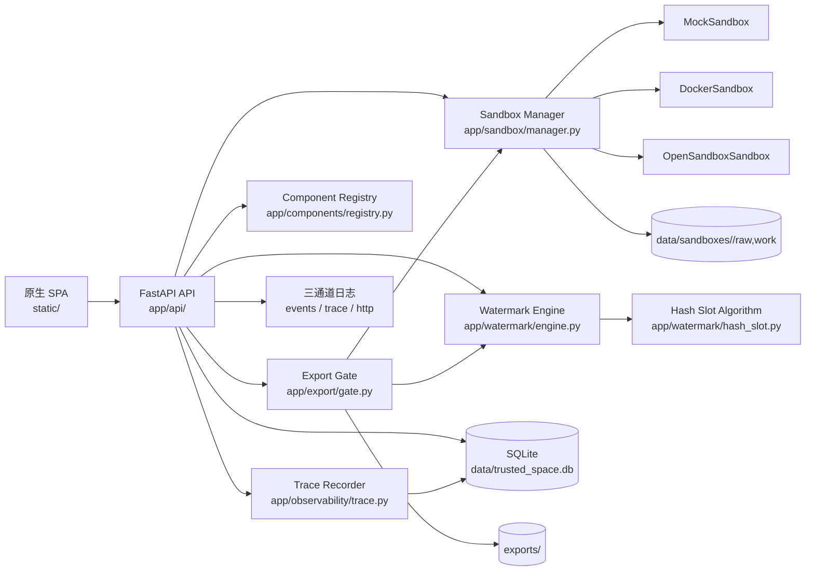

# 可信数据空间原型：核心实现文档

> 版本：2026-10-28  
> 适用范围：`/Users/bigmo/code/trusted-space-poc` 当前代码  
> 定位：本地可运行、可观察、可复核的工程原型，不是生产部署方案

> 动态演示：`docs/media/trusted-space-promo-light.gif`（32.5 秒，1280×720，明亮主题）。该宣传片由真实运行证据驱动生成，不是屏幕录制；9 个场景包含开源技术栈与阿里云目标架构，数据来源、主题切换和重生成方法见 `docs/media/README.md`。
>
> 阿里云部分目前是目标设计和迁移计划，尚未部署。完整方案见 [`ALIYUN_INTEGRATION.md`](ALIYUN_INTEGRATION.md)。

## 目录

- [1. 文档目标与实现边界](#1-文档目标与实现边界)
- [2. 快速运行与环境隔离](#2-快速运行与环境隔离)
- [3. 总体架构](#3-总体架构)
- [4. 标识体系与关联关系](#4-标识体系与关联关系)
- [5. 持久化模型与状态机](#5-持久化模型与状态机)
- [6. 沙箱运行时的核心实现](#6-沙箱运行时的核心实现)
- [7. 出域闸门](#7-出域闸门)
- [8. 数据水印：核心算法与证据链](#8-数据水印核心算法与证据链)
- [9. 可观测性：事件、trace 与 HTTP 日志](#9-可观测性事件trace-与-http-日志)
- [10. 组件注册表与闭环自检](#10-组件注册表与闭环自检)
- [11. API 与前端入口](#11-api-与前端入口)
- [12. 可复核步骤](#12-可复核步骤)
- [13. 生产化前必须补齐的部分](#13-生产化前必须补齐的部分)
- [14. 附录](#14-附录)
- [15. 结论](#15-结论)

---

## 1. 文档目标与实现边界

本原型把“可信数据空间”中最容易停留在概念层的四件事做成了可执行链路：

1. 代码在沙箱中运行，原始数据只读、工作数据可写。
2. 文件出域前必须经过分级判定和审批闸门。
3. 文件落盘前强制嵌入可提取的数据水印，而不是只在页面显示一个水印编号。
4. 每一次沙箱生命周期、算法步骤、审批状态迁移都可从日志、trace、数据库和 CLI 独立核验。

### 1.1 已经真实实现的能力

| 能力 | 实现方式 | 可核验证据 |
| --- | --- | --- |
| 沙箱隔离 | `MockSandbox` / `DockerSandbox` / `OpenSandboxSandbox` 统一接口 | `sandbox.*` 事件、`sandbox.create/exec/destroy` trace、容器启动参数 |
| 原始卷只读 | 代码静态扫描 + `write_file` 拒绝 + Docker 只读 bind mount | `sandbox.policy.scan`、`raw_write_blocked` 审计、HTTP 403 |
| 分级审批 | L1/L2 快速通道；L3/L4 三级审批状态机 | `export_requests.status`、`approval_stage`、`approval.stage.transition` trace |
| 强制水印 | 导出网关在写文件前调用 `watermark-engine` | `watermark.*` trace、`watermark_mappings`、逐行证据 |
| 数据水印 | SHA256 哈希槽 + `amount` LSB + 3 份冗余 + CRC32 校验 | 输出文件真实数值变化、导出后回读、上传泄露文件反查 |
| 业务日志 | 独立 INFO 事件流 | `logs/events.log`、终端、审计页 |
| 算法细粒度观测 | 独立 trace 流和数据库追踪 | `logs/trace.log`、`execution_traces/steps` |
| 组件自检 | 沙箱闭环、水印闭环 | `POST /api/components/{id}/self-test`、CLI `--selftest` |

### 1.2 明确不是生产安全边界

- Mock 沙箱是同机 Python 子进程，不是容器、虚拟机或安全隔离边界。
- 原始卷写保护在 Mock 后端主要是应用层策略；Docker 后端才具备内核级只读挂载。
- 当前没有登录、RBAC、审批人身份认证、电子签章、密钥托管和 WAF。
- 水印用于“泄露关联和追责辅助”，不是加密、DRM、数字签名或不可移除的证明。
- SQLite、本地文件和本地日志适合单机演示，不适合多节点生产部署。

---

## 2. 快速运行与环境隔离

### 2.1 推荐启动方式

```bash
cd /Users/bigmo/code/trusted-space-poc
./start.sh
```

`start.sh` 的判断顺序是：

1. 如果存在可执行的 `.venv/bin/python`，使用它。
2. 否则使用 `${PYTHON:-python3}`。
3. 启动 `uvicorn app.main:app`，默认监听 `127.0.0.1:8000`。

启动后访问：

```text
http://localhost:8000/
```

### 2.2 当前 `.venv` 的真实情况

当前机器的 `.venv/pyvenv.cfg` 显示：

```text
home = /opt/homebrew/Caskroom/miniconda/base/bin
include-system-site-packages = true
version = 3.13.2
```

这意味着：

- 当前项目使用的是由 miniconda base 创建的项目 venv。
- 项目 venv 中安装的包不会写入 conda base。
- 但由于开启了 `--system-site-packages`，它会复用 conda base 的 site-packages，**不是严格隔离**。
- 当前环境使用 Python 3.13.2，而 README 推荐 Python 3.11。
- 当前 `.venv` 中没有安装 `pytest`。

如果只是避免污染 base，应始终使用：

```bash
cd /Users/bigmo/code/trusted-space-poc
./.venv/bin/python -m pip install <package>
```

不要执行裸 `pip install`，也不要在 conda base 中安装本项目依赖。

如果要求严格隔离，建议新建一个不带系统包的 venv，并在其中完整安装依赖：

```bash
cd /Users/bigmo/code/trusted-space-poc
python3.11 -m venv .venv-isolated
./.venv-isolated/bin/python -m pip install -r requirements.txt
./.venv-isolated/bin/python -m uvicorn app.main:app --host 127.0.0.1 --port 8000
```

如果机器没有 `python3.11`，需要先用系统包管理器安装 Python 3.11；不要为了补依赖去修改 conda base。

### 2.3 重启服务

```bash
cd /Users/bigmo/code/trusted-space-poc
PID=$(lsof -ti tcp:8000)
[ -z "$PID" ] || kill $PID
./start.sh
```

需要热重载时：

```bash
cd /Users/bigmo/code/trusted-space-poc
RELOAD=1 ./start.sh
```

---

## 3. 总体架构



### 3.1 代码分层

| 层 | 目录 | 责任 |
| --- | --- | --- |
| HTTP/API | `app/api/`、`app/main.py` | 参数校验、响应封装、HTTP request id、访问日志 |
| 业务编排 | `app/export/gate.py`、`app/sandbox/manager.py` | 审批、出域、沙箱生命周期 |
| 算法 | `app/watermark/hash_slot.py`、`app/watermark/engine.py` | 水印帧、嵌入、提取、证据 |
| 运行时适配 | `app/sandbox/runtimes.py` | Mock、Docker、OpenSandbox 三种后端 |
| 持久化 | `app/db.py`、`app/trace/repository.py` | 元数据、映射、审计、执行追踪 |
| 可观测性 | `app/logging_config.py`、`app/observability/` | 事件日志、trace、CLI 格式化 |
| 组件治理 | `app/components/registry.py` | 真实探测、健康状态、闭环自检 |
| 前端 | `static/` | 路由、可视化、证据卡片、文件上传 |

### 3.2 一次完整业务链

```text
启动应用
  → 初始化 SQLite 与表结构
  → 恢复 RUNNING 沙箱
  → 创建/复用 sbx-demo 与种子原始卷
创建沙箱
  → 分配 SBX-ID
  → 创建 raw/work 卷目录
  → 初始化运行时
  → 登记 sandboxes 表，状态 RUNNING
在沙箱中执行 Python
  → 静态扫描原始卷写操作
  → 物化逻辑挂载路径
  → 启动 Python 子进程/容器命令
  → 回写工作卷
  → 清理临时目录
申请出域
  → 校验路径、文件存在性、字段
  → L1/L2 fast；L3/L4 approval
审批
  → Owner → Security → Compliance
执行出域
  → 再次校验 approved
  → 读取工作文件
  → 生成水印载荷与水印 ID
  → 嵌入 amount LSB
  → 立即重新提取并回读校验
  → 写 exports/
  → 登记 watermark_mappings 和 evidence_json
  → 更新申请为 exported
溯源
  → 上传 CSV
  → 哈希槽回收 + 多数投票 + CRC 校验搜索
  → 得到 watermark_id 和导出人
  → 查询映射与七步时间线
```

---

## 4. 标识体系与关联关系

| 标识 | 格式/生成规则 | 用途 |
| --- | --- | --- |
| 沙箱 ID | `SBX-YYYYMMDD-<uuid hex 前 6 位>` | 标识运行时和卷目录 |
| 出域申请 ID | `EXP-YYYYMMDD-<uuid hex 前 6 位大写>` | 审批和导出事务主键 |
| 水印 ID | `WM-YYYYMMDD-<payload SHA256 前 8 位>` | 水印映射与溯源入口 |
| 执行 trace ID | `TRC-YYYYMMDD-<uuid hex 前 10 位>` | 一次业务操作的完整阶段链 |
| HTTP request ID | `<uuid hex 前 10 位>` | HTTP 访问日志与业务 trace 关联 |
| 文件 ID | 源 CSV SHA256 的前 12 位 | 水印载荷中的内容指纹摘要 |
| 文件 hash | 导出文件完整 SHA256 | 完整性记录 |

必须区分三个容易混淆的 `request_id`：

1. **出域申请 ID**：`EXP-...`，是水印载荷里的 `request_id`。
2. **HTTP request id**：由中间件生成，只用于关联 `http.log` 和 trace 的 `http_request_id`。
3. **trace_id**：`TRC-...`，用于关联 `execution_traces`、`execution_steps` 和 `trace.log`。

浏览器请求 `/api/export/{request_id}/execute` 时，响应中的 `trace_id` 才对应后端执行细节；申请 ID 本身不是 trace ID。

---

## 5. 持久化模型与状态机

数据库默认路径：

```text
data/trusted_space.db
```

主要表：

| 表 | 内容 |
| --- | --- |
| `sandboxes` | 沙箱 ID、任务、状态、后端、创建/销毁时间 |
| `data_assets` | 5 条演示数据资产及分级 |
| `export_requests` | 申请、文件、申请人、接收方、分级、状态、审批阶段、水印 ID |
| `watermark_mappings` | 水印 ID、申请人、文件 hash、数据范围、审批链、逐行证据 JSON |
| `audit_logs` | 操作审计：创建、执行、阻断、嵌入、提取、导出 |
| `execution_traces` | 一次业务操作的总记录 |
| `execution_steps` | 该操作的逐阶段记录、耗时、参数摘要 |

### 5.1 出域状态

```text
L1/L2:
request → approved → exported

L3/L4:
request → pending(stage=0)
  → approve → pending(stage=1, Security)
  → approve → pending(stage=2, Compliance)
  → approve → approved(stage=3)
  → exported
```

`approval_stage` 的含义：

| stage | 当前节点 | approve 后 |
| --- | --- | --- |
| 0 | Owner | stage=1，Security |
| 1 | Security | stage=2，Compliance |
| 2 | Compliance | stage=3，approved |
| 3 | 已完成 | 不再允许审批 |

`reject` 可从任一阶段把状态改为 `rejected`；`transfer` 记录转交审计，但当前实现不推进 `approval_stage`，只把展示上的 `next_node` 指向下一节点。生产化时应增加明确的审批人分配、角色鉴权、转交目标和过期时间。

### 5.2 工作目录

```text
data/sandboxes/<sandbox_id>/raw/    # 逻辑路径 /mnt/raw
data/sandboxes/<sandbox_id>/work/   # 逻辑路径 /mnt/work
exports/<watermark_id>_<filename>   # 出域文件
logs/events.log
logs/trace.log
logs/http.log
```

启动时 `init_db()` 会补做轻量迁移：

- `export_requests.approval_stage`
- `sandboxes.backend`
- `watermark_mappings.evidence_json`

旧水印记录没有 `evidence_json` 时，证据 API 返回 `available=false`，但映射和时间线仍可查询。要看到逐行水印证据，必须重启到新代码后重新执行一次导出。

---

## 6. 沙箱运行时的核心实现

### 6.1 统一运行时契约

`SandboxManager` 和三种后端共享以下能力：

```text
ensure_storage()
load_storage()
write_file(path, bytes)
read_file(path)
list_files()
exec(code, actor, ip)
destroy()
```

后端由环境变量选择：

```bash
SANDBOX_BACKEND=mock ./start.sh
SANDBOX_BACKEND=docker ./start.sh
SANDBOX_BACKEND=opensandbox ./start.sh
```

未设置时默认 `mock`；三者状态在 `#/components` 和 `GET /api/components` 中可看到探测结果。组件页不会把未安装的 SDK 显示为 ready。

### 6.2 创建生命周期

`SandboxManager.create()` 的顺序是：

1. 写入 INFO 事件 `sandbox.creating`。
2. 创建 `TRC-...` 的 `sandbox.create` trace。
3. 分配 `SBX-...`。
4. 初始化 `raw`、`work` 卷目录。
5. 对 Docker/OpenSandbox 初始化真实运行时；Mock 只记录运行时类型。
6. 登记内存注册表和 `sandboxes` 表。
7. 写审计 `sandbox.create`。
8. 写事件 `sandbox.initialized`、`sandbox.created`。
9. trace 结果返回 `trace_id`、卷和状态。

事件示例：

```text
event=sandbox.creating sandbox_id=SBX-... backend=mock ...
event=sandbox.initialized sandbox_id=SBX-... backend=mock volumes=raw:ro,work:rw trace_id=TRC-...
event=sandbox.created sandbox_id=SBX-... backend=mock status=RUNNING trace_id=TRC-...
```

### 6.3 MockSandbox 执行细节

Mock 后端用于零依赖演示，执行流程是真实子进程，不是纯前端模拟：

1. 创建 `sandbox.exec` trace。
2. 写 `sandbox.exec.started` INFO 事件。
3. 用正则扫描代码中的 `/mnt/raw` 写操作。
4. 创建临时根目录 `ts-<sandbox_id>-...`。
5. 在临时目录下创建 `mnt/raw`、`mnt/work`。
6. 将内存中的文件写入临时卷，同时记录每个文件的 SHA256。
7. 将代码中的逻辑路径 `/mnt/raw`、`/mnt/work` 替换成宿主临时路径。
8. 以 `python3 -c <code>` 运行，工作目录为临时 `mnt/work`。
9. 超时默认 10 秒，超时写 `sandbox.exec.timeout` 并抛业务错误 1004。
10. 子进程结束后，只把临时 `mnt/work` 中的文件同步回内存和持久卷。
11. 不把临时 `mnt/raw` 回写。
12. 清理临时目录。
13. 写 `sandbox.exec.completed`、审计 `sandbox.exec` 和 trace 结果。

关键 trace 阶段：

```text
sandbox.state.check
sandbox.policy.scan
sandbox.workspace.allocate
sandbox.volumes.materialize
sandbox.mount.rewrite
sandbox.process.exit
sandbox.volume.sync
sandbox.storage.persist
sandbox.workspace.cleanup
```

其中 `sandbox.workspace.allocate` 同时记录逻辑挂载和宿主临时路径，`sandbox.mount.rewrite` 记录替换次数。这样可以从 trace 看出“代码里的 `/mnt/work` 如何实际变成宿主目录”，而不是只看到一句成功。

#### Mock 写保护

两层检查：

1. `exec()` 在启动子进程前调用 `_raw_write_line()`，匹配 `open(..., "w")`、`os.open` 写标志、Pandas/文件写入调用、shell 重定向、`tee`、`shutil.copy/move` 等模式。
2. `write_file()` 无论如何拒绝 `/mnt/raw` 路径。

这能拦截演示中的明显违规代码，但不是安全沙箱：

- 路径替换是纯字符串替换，不是 AST 重写。
- 正则可被动态拼接、间接调用等方式绕过。
- 子进程与主服务使用同一系统用户和文件权限。
- 生产环境必须使用 Docker、OpenSandbox 或更强的隔离运行时。

### 6.4 DockerSandbox

创建容器时的关键参数：

```text
--network none
--cap-drop ALL
--security-opt no-new-privileges
--pids-limit 256
--memory 512m
--cpus 1
--read-only
--tmpfs /tmp:rw,nosuid,nodev,size=64m
--mount type=bind,src=<sandbox>/raw,dst=/mnt/raw,readonly
--mount type=bind,src=<sandbox>/work,dst=/mnt/work
--workdir /mnt/work
--entrypoint /bin/sleep
<image> infinity
```

执行时使用：

```text
docker exec -i <container> python -c <code>
```

因此 Docker 后端具备：

- 内核级只读原始卷；
- 网络隔离；
- 资源限制；
- 只读根文件系统；
- 容器级生命周期。

仍需注意：

- Docker daemon 权限本身就是高权限边界。
- 镜像必须提前准备，`docker_health()` 会检查 binary、daemon、image。
- 容器复用和沙箱 ID 绑定，销毁会 `docker rm -f`。
- 生产环境还应加 seccomp/AppArmor、镜像签名、只读网络代理和运行时漏洞扫描。

### 6.5 OpenSandboxSandbox

OpenSandbox 接入点有两层：

1. **自动 SDK 反射适配器**：导入 `opensandbox`，寻找 `Sandbox`、`SandboxClient`、`Client` 工厂，以及 `write_file`、`run_command`、`read_file` 等方法名。
2. **自定义 adapter**：设置 `OPENSANDBOX_ADAPTER=module:factory`，工厂接收沙箱对象并返回实现 `create/upload_files/execute/download_work/destroy` 的适配器。

自动反射只是兼容性桥接，不代表远端服务一定可用。组件健康检查会区分：

- SDK 未安装 → `unavailable`；
- SDK 已安装但无明确工厂或适配器未经服务端验证 → `degraded`；
- 自定义 adapter 配置存在 → 标记 ready 候选，但仍需首次真实创建来验证连通性。

生产接入必须用真实 OpenSandbox SDK/服务验证：

- 远端卷映射是否真正只读；
- 执行命令是否以 `python -c` 或等价方式传入；
- 新建工作文件是否能被 `download_work()` 拉回；
- 销毁是否清理远端资源；
- 网络和资源策略是否由服务端强制执行。

当前 `SDKOpenSandboxAdapter.download_work()` 只遍历本地已有的工作文件路径，因此不能仅凭它证明“远端新生成文件”一定被同步回来；这是接真实服务时必须重点验证和替换的地方。

### 6.6 恢复与销毁

启动时 `seed_demo()` 会先扫描数据库中状态为 `RUNNING` 的沙箱，再从 `data/sandboxes/<id>` 恢复文件。工作卷持久化在磁盘上，所以服务重启不会自动丢掉已生成的工作文件。

销毁流程：

```text
sandbox.destroy trace
  → 检查沙箱
  → 统计工作卷文件数
  → 运行时 destroy
  → 删除工作卷目录
  → sandboxes.status = DESTROYED
  → 写 sandbox.destroyed INFO 事件
```

销毁后 `get()` 不再返回该运行沙箱，读取文件返回业务错误 1001。

### 6.7 如何观测沙箱是否真的存在、是否正在运行

**不能只看数据库里的 `status='RUNNING'`。** 这个字段只证明“曾经创建并登记过”，不能证明当前进程认识它、运行时仍可接受命令、卷仍然完整。服务重启、Docker 容器被外部停止、目录被手工删除、进程崩溃，都可能让数据库与真实状态不一致。

因此 `SandboxManager.observe()` 对每个沙箱做五项联合检查：

| 检查项 | 证据来源 | 能回答的问题 |
| --- | --- | --- |
| `database.record` | SQLite `sandboxes` 表 | 是否有创建记录？ |
| `database.running` | `sandboxes.status` | 数据库是否认为它运行中？ |
| `process.registry` | `SandboxManager._sandboxes` 内存表 | 当前 FastAPI 进程是否持有该运行时对象？ |
| `runtime.live` | Mock 状态 / `docker inspect` / OpenSandbox adapter | 运行时此刻是否存活并可接受操作？ |
| `storage.volumes` | `data/sandboxes/<id>/{raw,work}` | 两类持久卷目录是否都存在？ |

最终结论不是模糊的“好像在运行”，而是以下枚举之一：

| verdict | 含义 | 常见原因 |
| --- | --- | --- |
| `RUNNING_VERIFIED` | 五项全部通过，运行事实已在服务进程内核验 | 正常创建或恢复 |
| `EXTERNAL_CONSISTENCY` | 数据库与卷一致，但 CLI 看不到服务进程内存 | CLI 独立进程查询；需再调服务端 API |
| `STALE_RUNNING` | 数据库仍为 `RUNNING`，但内存或运行时不可用 | 容器被停止、服务异常、运行时初始化失败 |
| `ORPHANED_RUNTIME` | 内存里有运行时，但数据库/卷不一致 | 数据库被清理或卷目录被删除 |
| `NOT_RUNNING` | 有历史记录，但已停止或销毁 | 正常销毁 |
| `ORPHANED_STORAGE` | 只剩卷目录，无数据库和运行时记录 | 手工删除数据库、恢复失败 |

全量扫描同时枚举 SQLite 记录、当前内存注册和 `data/sandboxes/` 实际目录，因此也能发现“数据库记录丢失但目录仍残留”的孤儿卷。

#### 服务端 API

```bash
cd /Users/bigmo/code/trusted-space-poc

# 全部沙箱及聚合数量
curl -s http://127.0.0.1:8000/api/sandbox/status | ./.venv/bin/python -m json.tool

# 单个沙箱：五项检查、运行时说明、卷文件数、最近活动
curl -s http://127.0.0.1:8000/api/sandbox/sbx-demo/status | ./.venv/bin/python -m json.tool
```

典型运行结果：

```json
{
  "sandbox_id": "SBX-20261028-3bb39f",
  "verdict": "RUNNING_VERIFIED",
  "probe_scope": "service_process",
  "checks_passed": 5,
  "runtime": {
    "mode": "on_demand",
    "live": true,
    "long_lived_process": false,
    "detail": "MockSandbox 按需启动 python3 子进程；RUNNING 表示已注册且可接受执行"
  },
  "storage": {"exists": true, "raw_exists": true, "work_exists": true}
}
```

#### CLI 查询及它的边界

```bash
./.venv/bin/python -m app.cli sandboxes
./.venv/bin/python -m app.cli sandboxes --running
./.venv/bin/python -m app.cli sandbox sbx-demo
./.venv/bin/python -m app.cli sandbox sbx-demo --json
```

CLI 是新进程，天然看不到正在运行的服务进程内存，所以它把 `process.registry` 和 `runtime.live` 标为 `N/A`，结论显示 `EXTERNAL_CONSISTENCY`（3/5 项可核对），这不是失败。CLI 的职责是核对数据库与磁盘卷；若这两项一致，再用服务端 `/api/sandbox/{id}/status` 获取 `RUNNING_VERIFIED`。

#### 不同后端的“运行”含义

| 后端 | 真实运行证据 | 边界 |
| --- | --- | --- |
| `mock` | 内存注册 + 卷完整 + 可按需启动 `python3` 子进程 | **没有长驻 PID**；执行结束后子进程退出，临时工作目录被删除 |
| `docker` | `docker inspect --format '{{json .State}}'` 的 `State.Running=true` | 需 Docker daemon；容器被外部停止会变成 `STALE_RUNNING` |
| `opensandbox` | adapter 已建立且状态为 `RUNNING` | 当前只证明 adapter 存在，**不能单独证明远端服务健康**；需 SDK 健康探测或执行探针 |

#### 最强证明：执行一条无害命令

状态接口是控制面证据；要证明数据面也能工作，执行一条只读命令：

```bash
curl -s -X POST http://127.0.0.1:8000/api/sandbox/sbx-demo/exec \
  -H 'Content-Type: application/json' \
  -d '{"code":"print(\"sandbox-probe-ok\")"}' | ./.venv/bin/python -m json.tool
```

成功后会新增一条 INFO 级 `sandbox.exec.completed`，其中包含 `status=success`、`exit_code=0`、`duration_ms` 和 `trace_id`。随后用同一 `trace_id` 查看执行阶段：

```bash
./.venv/bin/python -m app.cli trace <TRACE_ID>
```

这比“页面显示绿色”更强：控制面注册、运行时调用、子进程退出码和 trace 证据同时成立。

---

## 7. 出域闸门

### 7.1 申请阶段

`POST /api/export/request` 进入 `export.request` trace，依次执行：

1. 生成 `EXP-...`。
2. 查询沙箱，确认状态。
3. `normalize_path()` 规范化路径，拒绝 `..`。
4. 判断目标是否位于 `/mnt/raw`。
5. 原始卷直接拒绝，返回 1005/HTTP 403，并写 `unauthorized_export` 审计。
6. 检查目标文件是否在工作卷存在。
7. 校验申请人、用途、接收方。
8. 按分级决定通道。
9. 写 `export_requests`。
10. 写 `export.requested` 事件和审计。

### 7.2 分级与审批

| 数据分级 | 通道 | 初始状态 | 审批链 |
| --- | --- | --- | --- |
| L1 | fast | approved | 无 |
| L2 | fast | approved | 无 |
| L3 | approval | pending | Owner → Security → Compliance |
| L4 | approval | pending | Owner → Security → Compliance |

`approve`、`reject`、`transfer` 都在 `export.approval` trace 内记录：

```text
approval.policy.channel
approval.stage.transition
database.export_request.update
audit.write
```

`approval.stage.transition` 的 detail 至少包含：

```json
{
  "from_stage": 0,
  "from_node": "Owner",
  "decision": "approve",
  "to_stage": 1,
  "to_node": "Security",
  "new_status": "pending"
}
```

当前状态机没有把“审批人角色”与“当前 stage”做强制绑定，也没有身份认证。任何调用者只要提交审批人字符串并满足状态条件，就能推进一步；这是原型必须明确的生产缺口。

### 7.3 执行阶段

`POST /api/export/{request_id}/execute` 进入 `export.execute` trace：

1. 加载申请。
2. 如果已经 `exported` 且有水印 ID，走幂等复用，发 `export.reused`。
3. 如果状态不是 `approved`，阻断并写 `unauthorized_export`。
4. 获取沙箱并读取源文件。
5. 计算源文件 SHA256，取前 12 位作为 `file_id`。
6. 调用水印引擎嵌入。
7. 生成逐行证据。
8. **立即从嵌入后的内存数据重新提取**，校验 ID、完整 payload、CRC。
9. 校验通过后才写 `exports/`。
10. 写 `watermark_mappings` 和 `evidence_json`。
11. 更新申请为 `exported`。
12. 写审计和 `watermark.embedded`、`export.completed` 事件。

核心不变量：

- 原文不能直接落盘。
- 只有 `approved` 申请可以进入水印写入。
- 水印写入后必须回读成功才算导出完成。
- 导出文件名以水印 ID 为前缀，但水印识别不依赖文件名。
- 同一申请重复 execute 返回已有结果，不重复嵌入。

注意：文件落盘和数据库登记不是跨文件系统与 SQLite 的分布式事务。如果写文件成功但数据库写入失败，会留下无映射的导出文件。生产环境应使用 outbox/事务日志或对象存储事务。

---

## 8. 数据水印：核心算法与证据链

### 8.1 目标

水印用于回答：

```text
这份被泄露的 CSV 最初由谁、在什么时间、基于哪个出域申请导出？
```

它不是把 `WM-...` 明文写进 CSV，也不是给文件添加可见印章。它把一段压缩业务载荷编码到数字承载列的最低位中。

### 8.2 载荷与水印 ID

导出时载荷如下：

```json
{
  "watermark_id": "WM-20261028-321f7a4a",
  "user_id": "alice",
  "export_time": "20261028T150608",
  "file_id": "c69ea7132c4e",
  "request_id": "EXP-20261028-BCAD8C"
}
```

生成步骤：

1. 将 `user_id`、`export_time`、`file_id`、`request_id` 按固定顺序组成 JSON。
2. 用 UTF-8 编码。
3. 计算 SHA256。
4. 取十六进制摘要前 8 位。
5. 生成 `WM-YYYYMMDD-<digest8>`。
6. 把水印 ID 放进完整 payload。

因此水印 ID 由业务上下文决定，不是随机数；相同字段会得到相同 ID。若需要绝对防重放，生产环境还应引入服务端随机 nonce 或签名。

### 8.3 固定帧格式

载荷先 `zlib.compress(..., level=9)`，再放入固定头：

```text
偏移  长度  字段
0     2     MAGIC = b"TS"
2     1     VERSION = 1
3     2     compressed length，大端
5     4     CRC32(compressed)，大端
9     N     zlib-compressed JSON
```

代码位于 `app/watermark/hash_slot.py` 的 `HEADER` 和 `_build_frame()`。

限制：

- 帧最大 512 字节。
- 压缩长度字段最大 65535 字节，但实际先受 512 字节帧上限约束。
- CRC 只覆盖压缩载荷，不覆盖头字段；提取时还会额外校验 MAGIC、version、长度和 JSON 必需字段。

实际样例：

```text
frame_bytes=134
compressed_bytes=125
header=9
crc32=d93ea751
frame_sha256=993e64e6...
```

### 8.4 哈希槽定位

设：

```text
frame_bits = frame_bytes * 8
total_slots = frame_bits * REPEAT
REPEAT = 3
```

对每一行 `customer_id`：

```text
slot = int(sha256(customer_id)[:8], 16) % total_slots
bit = full_bitstream[slot]
```

然后把 `bit` 写入该行 `amount` 的整数最低位：

```text
amount 整数最低位 = 0  → amount 为偶数
amount 整数最低位 = 1  → amount 为奇数
```

完整比特流是：

```text
frame_bits + frame_bits + frame_bits
```

即同一个帧的三份副本连续排列。`slot // frame_bits` 表示副本编号 0/1/2，页面显示为 1/3、2/3、3/3；`slot % frame_bits` 是该副本内的帧位偏移。

### 8.5 一个可手工复核的例子

以当前数据库中的 `WM-20261028-321f7a4a` 为例：

```text
frame_bytes = 134
frame_bits = 1072
total_slots = 3216
customer_id = C000001
sha256_prefix = 602dcf01
0x602dcf01 % 3216 = 2929
副本 = 2929 // 1072 = 2（第三份）
帧位 = 2929 % 1072 = 785
目标 bit = 0
amount 原值 = 101，LSB = 1
amount 导出值 = 100，LSB = 0
数值差 = 1
```

同一批证据中还有：

```text
C000003: 103 -> 102, LSB 1->0, slot=112,  replica=1/3
C000004: 104 -> 105, LSB 0->1, slot=2003, replica=2/3
```

这些不是固定文案，而是 `build_embedding_evidence()` 对原始 CSV 和导出 CSV 逐行重新计算哈希槽、读取 LSB、计算 Decimal 差值和改动行数得到的。

### 8.6 amount 的数值语义

实现先把 `amount` 解析为 `Decimal`，取小数位数，放大成整数：

```text
amount = "100.50"
decimals = 2
scale = 100
integer = 10050
LSB = 0
```

修改后仍按原小数位数格式化。因此：

- 整数 amount 的最大数值扰动是 1；
- 两位小数 amount 的最大扰动是 0.01；
- 一位小数 amount 的最大扰动是 0.1；
- 负数保留符号；
- 只调整整数最低位，不做四舍五入或缩放。

页面/证据中的 `max_amount_delta` 是 Decimal 层面的实际最大差，而不是固定写成 1。trace 里的 `max_numeric_delta=1` 指放大后整数的最低位单位。

### 8.7 为什么需要三份副本

一行只承载一个槽位，但 CSV 行可能被删除、重排或发生哈希碰撞：

1. 水印帧被完整复制三次。
2. 同一个帧位有三个独立槽位。
3. 提取时对三份副本投票。
4. 只有三份都缺失时，该帧位才记为 unknown。

对于当前 5000 行样例：

```text
帧 134 B → 1072 个帧位 → 3216 个槽位
5000 行 → 约 5000 次槽位写入，必然有碰撞
```

碰撞处理目前是“后写覆盖前写”：同一次嵌入按文件行顺序遍历，同一 slot 的最后一行生效；提取按同样规则放入 slot。因此：

- 删除少量行通常仍能恢复；
- 完全打乱行序时，碰撞槽的最终值可能改变，但多数投票和 CRC 搜索能吸收少量未知/冲突位；
- 这不是数学上无限鲁棒的纠错码，不能保证任意删行、改值和重排后都可恢复。

### 8.8 嵌入伪代码

```python
payload = make_payload(user_id, export_time, file_id, request_id)
frame = zlib.compress(json(payload)) 加 9 字节头
bits = frame_bits * 3

for row in rows:
    slot = sha256(row.customer_id)[:8] % len(bits)
    bit = bits[slot]
    row.amount = set_lsb(row.amount, bit)
```

### 8.9 提取算法

提取入口是 `extract_csv()`：

1. 解析 UTF-8 CSV，要求 `customer_id` 和 `amount` 两列。
2. 逐行计算 SHA256 前 32 位整数和 amount LSB。
3. 跳过空 ID、列数不足的行。
4. 有效行少于 32 行直接失败。
5. 猜测帧长度，范围从 header+1 到 `min(512, rows//6)`，且至少 header+1。
6. 对每个帧长度重建 `total_slots`。
7. 按哈希槽散列填入三份副本。
8. 对每个帧位做多数投票：2:1 取多数，1:1 取已有值，0 份记为 unknown。
9. unknown 位超过 20 个则放弃该候选。
10. 先用 MAGIC 比特过滤明显错误的长度。
11. 在未知位上枚举 0/1 组合。
12. 对每个候选验证：MAGIC、version、压缩长度、CRC32、zlib 解压、JSON 解析、必需字段。
13. 第一个通过的候选作为结果。
14. `match_score = 已知帧位数 / 帧总位数 × 100`。

伪代码：

```python
known = 0
for bit_index in range(frame_bits):
    copies = [
        slot[bit_index],
        slot[bit_index + frame_bits],
        slot[bit_index + 2 * frame_bits],
    ]
    values = [v for v in copies if v is not None]
    if not values:
        unknown.append(bit_index)
    else:
        known += 1
        message[bit_index] = majority(values)

for assignment in 2 ** len(unknown):
    candidate = patch_unknown_bits(message, assignment)
    if validate_frame(candidate):
        return decode(candidate)
```

### 8.10 match_score 的正确解释

`match_score` 表示：

```text
有多少帧位至少有一份副本可读
```

它不是“水印 ID 与原文相似度”，也不是“文件完整度”。样例中的 `99.16%` 同时伴随 `unknown_bits=9`、`corrected_bits=9` 和 `crc32_verified=true`，含义是 9 个未知帧位通过 CRC 约束搜索补齐后成功解出。

代码中的 `unknown_bits` 与 `corrected_bits` 都来自 `len(unknown_positions)`；前者表示缺失位数量，后者表示搜索修复的数量。若已知位被恶意改坏，不能靠 CRC 自动纠正，通常会导致帧校验失败。

### 8.11 逐行证据档案

`build_embedding_evidence()` 生成并保存到 `watermark_mappings.evidence_json` 的结构包括：

```text
algorithm.version / method / steps / carrier_column / slot_rule
frame.magic / version / compressed_bytes / frame_bytes / frame_bits /
      repeat / total_slots / crc32 / sha256
payload
files.source.bytes / sha256
files.output.bytes / sha256
diff.rows_total / changed_rows / unchanged_rows / changed_ratio /
     max_amount_delta / changed_samples / unchanged_samples
verification.status / expected_watermark_id / extracted_watermark_id /
             watermark_id_match / payload_match / match_score /
             unknown_bits / corrected_bits / crc32_verified
```

每个 `changed_samples` 项包含：

```text
row_number
customer_id
sha256_prefix
slot
replica
frame_bit
target_bit
lsb_before
lsb_after
amount_before
amount_after
delta
```

证据不是“截图”，而是导出时对原始和输出 CSV 的逐行复算；同时用 `source.sha256 != output.sha256` 证明文件内容确实发生变化。

### 8.12 为什么在文件里搜索不到 WM-ID

下载文件的内容没有被添加一列 `watermark_id`，也没有写入明文注释。水印 ID 在 payload 中，payload 被：

```text
JSON → zlib 压缩 → 9 字节头 → 展开成比特 → 3 份冗余 → amount 奇偶位
```

因此直接在 CSV 中搜索 `WM-20261028-...` 通常找不到。正确验证方式是：

```bash
cd /Users/bigmo/code/trusted-space-poc
./.venv/bin/python -m app.cli watermark <WM-ID>
```

或上传文件到 `POST /api/trace/file`，由服务端重新提取。文件名带 `WM-...` 前缀只是导出命名约定，不是水印算法本身。

### 8.13 当前水印的适用边界

适合：

- 结构稳定、包含 `customer_id` 和 `amount` 的 UTF-8 CSV；
- 导出后仍保留这些列和大多数行；
- 用于内部泄露追溯和演示。

不适合直接宣称：

- 能抵抗任意重编码、列改名、金额全量重算；
- 能抵抗有意的统计分析或重放攻击；
- 能证明文档真实性；
- 能在任意小文件中嵌入任意长度载荷。

当前代码的容量约束、碰撞行为和 CRC 搜索上限都应在生产前通过更大规模数据、攻击样本和误码率实验重新评估。

---

## 9. 可观测性：事件、trace 与 HTTP 日志

### 9.1 三通道设计

| 文件 | Logger | 内容 | 控制台 |
| --- | --- | --- | --- |
| `logs/events.log` | `trusted_space.events` | INFO 业务生命周期事件 | 是 |
| `logs/trace.log` | `trusted_space.trace` | `trace.start/step/finish` 与算法细节 | 否 |
| `logs/http.log` | `trusted_space.http` | API 方法、路径、状态、耗时、IP、request_id | 否 |

每个文件使用 `RotatingFileHandler`：

```text
单文件最大 2 MiB，保留 3 个备份，UTF-8
```

设计原因：业务人员看 `events.log` 即可理解“沙箱何时创建/销毁、何时嵌入水印、审批走到哪一步”；开发人员再按 `trace_id` 追 `trace.log`；HTTP 访问量不会污染业务事件。

### 9.2 事件格式

```text
2026-10-28 15:06:08 | INFO | event=watermark.embedded watermark_id=WM-... request_id=EXP-... actor=alice algorithm=hash-slot-v1 method=sha256_hash_slot+amount_lsb+3x_repeat+crc32 rows=5000 changed_rows=2583 frame_bytes=134 verified=true match_score=99.16 trace_id=TRC-...
```

`log_event()` 保证：

- 单行；
- `event=` 后是稳定检索名；
- 值中含空格/引号时用 JSON 双引号；
- 复杂对象压缩成 JSON；
- 可直接 `grep` 或按字段检索。

### 9.3 事件字典

| 域 | 事件 |
| --- | --- |
| 应用 | `application.starting`、`database.initialized`、`application.ready` |
| 沙箱生命周期 | `sandbox.creating`、`sandbox.initialized`、`sandbox.created`、`sandbox.recovered`、`sandbox.demo.reused`、`sandbox.demo.ready`、`sandbox.destroyed`、`sandbox.backend.replaced` |
| 沙箱执行 | `sandbox.exec.started`、`sandbox.exec.completed`、`sandbox.exec.blocked`、`sandbox.exec.timeout`、`sandbox.exec.failed` |
| 水印 | `watermark.embedding`、`watermark.embedded`、`watermark.extracting`、`watermark.extracted`、`watermark.embed.failed`、`watermark.extract.failed` |
| 出域审批 | `export.requested`、`export.approved`、`export.rejected`、`export.transferred`、`export.blocked`、`export.reused`、`export.completed` |
| 组件自检 | `component.selftest.started`、`component.selftest.completed`、`component.selftest.failed` |

### 9.4 Trace 的持久化与关联

`TraceRecorder` 同时写两个地方：

1. `execution_traces` / `execution_steps`，供 API/CLI 查询。
2. `logs/trace.log`，供 tail/grep。

每个 trace 包含：

```text
trace_id, operation, status, actor, target,
input_json, result_json, error, started_at, finished_at, duration_ms
```

每个 step 包含：

```text
seq, phase, status, started_at, finished_at, duration_ms, detail_json
```

HTTP 中间件为每个 API 请求生成 `request_id`，通过 `ContextVar` 写入业务 trace 的 `http_request_id`。因此可以从一条 HTTP 访问记录跳到对应业务 trace，再跳到具体算法阶段。

`trace_logger` 的单条 detail 超过 40,000 字符时会截断并保存预览，避免把整个 CSV 写进数据库；字节内容会变成 `{type: "bytes", size, sha256}`，不会直接落库。

### 9.5 主要 trace 阶段

沙箱创建：

```text
sandbox.id.allocate
sandbox.volumes.initialize
sandbox.storage.initialize
sandbox.runtime.initialize
sandbox.runtime.register
database.sandbox.persist
audit.write
sandbox.running
```

沙箱执行：

```text
sandbox.state.check
sandbox.policy.scan
sandbox.workspace.allocate
sandbox.volumes.materialize
sandbox.mount.rewrite
sandbox.process.exit
sandbox.volume.sync
sandbox.storage.persist
sandbox.workspace.cleanup
```

水印嵌入：

```text
watermark.payload.build
watermark.frame.pack
watermark.bits.repeat
watermark.slots.map
watermark.amount.lsb
watermark.csv.serialize
watermark.roundtrip.verify
```

水印提取：

```text
watermark.input.read
watermark.csv.parse
watermark.bits.collect
watermark.frame.search
watermark.majority.vote
watermark.crc.repair
watermark.payload.decode
```

### 9.6 CLI 与 API 查看方式

```bash
cd /Users/bigmo/code/trusted-space-poc

# 业务事件，默认的 INFO 生命周期日志
./.venv/bin/python -m app.cli logs -f

# 算法与执行细节
./.venv/bin/python -m app.cli logs --source trace -f

# HTTP 访问
./.venv/bin/python -m app.cli logs --source http -f

# 最近 trace
./.venv/bin/python -m app.cli traces --limit 20

# 最近一次沙箱初始化
./.venv/bin/python -m app.cli trace --last --operation sandbox.seed

# 最近一次导出执行
./.venv/bin/python -m app.cli trace --last --operation export.execute

# 指定 trace 的完整阶段
./.venv/bin/python -m app.cli trace TRC-20261028-xxxxxxxxxx
```

API：

```text
GET /api/system/logs?source=events|trace|http&limit=100
GET /api/traces?operation=export.execute&limit=20
GET /api/traces/{trace_id}
GET /api/traces/{trace_id}/text
```

---

## 10. 组件注册表与闭环自检

组件中心不是静态卡片，`app/components/registry.py` 会对当前进程和磁盘做真实探测。

| 组件 | 真实探测 |
| --- | --- |
| `sandbox-runtime` | 当前后端、Mock/Docker/OpenSandbox 探测、能力、依赖、配置 |
| `watermark-engine` | 构造水印帧、检查 CSV 约束、算法配置 |
| `export-gate` | 水印可用性、导出目录可写、申请/导出计数 |
| `trace-store` | `execution_traces`、`execution_steps` 可读，最近 trace |
| `metadata-db` | SQLite `PRAGMA integrity_check`、必需表 |
| `artifact-store` | 卷目录、导出目录可写、磁盘剩余空间 |

### 10.1 沙箱自检

`python -m app.cli component sandbox-runtime --selftest` 会真实执行：

```text
创建新沙箱
  → 写入工作卷 marker 文件
  → 执行代码读回 marker
  → 校验 stdout
  → 销毁沙箱
```

返回结果包含嵌套的 `create_trace_id`、`write_trace_id`、`exec_trace_id`、`destroy_trace_id`，并写 INFO 事件 `component.selftest.*`。

### 10.2 水印自检

`python -m app.cli component watermark-engine --selftest` 会：

1. 生成 6000 行确定性 CSV。
2. 构造真实水印帧。
3. 嵌入 amount LSB。
4. 重新提取。
5. 校验 ID、用户、申请号、匹配度和改动行数。

API 自检只开放 `sandbox-runtime` 和 `watermark-engine`，没有真实闭环自检的组件会返回明确的“未提供运行时自检”，不会伪造 ready。

---

## 11. API 与前端入口

### 11.1 主要 API

| 方法 | 路径 | 作用 |
| --- | --- | --- |
| GET | `/api/health` | 服务健康与后端 |
| GET/POST | `/api/sandbox` | 列出/创建沙箱 |
| GET | `/api/sandbox/{id}/mounts` | 查看 raw/work 挂载 |
| POST | `/api/sandbox/{id}/exec` | 执行 Python |
| POST | `/api/sandbox/{id}/write` | 写工作卷 |
| GET | `/api/sandbox/{id}/files` | 列出工作文件 |
| GET | `/api/sandbox/{id}/files/{path}` | 下载工作文件；原始卷拒绝 |
| DELETE | `/api/sandbox/{id}` | 销毁沙箱 |
| GET | `/api/data/assets` | 查询数据资产 |
| POST | `/api/data/generate` | 生成演示 CSV |
| POST | `/api/export/request` | 创建出域申请 |
| GET | `/api/export/requests` | 列出申请 |
| GET | `/api/export/{id}` | 申请详情与脱敏预览 |
| POST | `/api/export/{id}/approve` | 审批推进/驳回/转交 |
| POST | `/api/export/{id}/execute` | 执行强制水印导出 |
| GET | `/api/export/{id}/download` | 下载导出文件 |
| GET | `/api/watermark/list` | 已导出水印列表 |
| POST | `/api/watermark/extract` | Base64 CSV 提取水印 |
| GET | `/api/watermark/{id}/evidence` | 水印逐行证据 |
| GET | `/api/watermark/{id}/download` | 下载水印文件 |
| GET | `/api/trace/{watermark_id}` | 按水印 ID 查询时间线 |
| POST | `/api/trace/file` | 上传 CSV 提取水印并溯源 |
| GET | `/api/traces` | 查询执行 trace |
| GET | `/api/traces/latest` | 最近 trace |
| GET | `/api/traces/{id}` | trace JSON |
| GET | `/api/traces/{id}/text` | trace 人读文本 |
| GET | `/api/system/logs` | 查看三通道日志 |
| GET | `/api/audit/logs` | 查询审计日志 |
| GET | `/api/components` | 组件列表与状态 |
| GET | `/api/components/{id}` | 组件详情 |
| POST | `/api/components/{id}/self-test` | 闭环自检 |
| GET | `/api/overview` | 首页指标 |

响应统一为：

```json
{"code": 0, "message": "ok", "data": {}}
```

业务错误通过 `code` 和 HTTP 状态码表达；`X-Trace-ID` 可在失败响应中定位后端 trace。

### 11.2 页面

| 路由 | 核心页面 |
| --- | --- |
| `#/overview` | 安全概览 |
| `#/assets` | 数据资产与分级 |
| `#/sandbox` | 沙箱挂载、代码编辑、执行控制台 |
| `#/components` | 组件探测与自检 |
| `#/export` | 申请、审批、导出 |
| `#/trace` | 按水印 ID/文件溯源，显示写入证据和七步时间线 |
| `#/audit` | 审计、执行 trace、三通道日志切换 |
| `#/help` | 使用说明 |

`#/trace` 的证据卡片展示：承载列、SHA256 前缀与槽位、副本编号、amount 前后值、LSB 变化、最大扰动、改动比例、回读匹配度、CRC 修复数。它读取 `/api/watermark/{id}/evidence`，不是前端硬编码。

---

## 12. 可复核步骤

### 12.1 重启并生成新证据

终端 A：

```bash
cd /Users/bigmo/code/trusted-space-poc
PID=$(lsof -ti tcp:8000)
[ -z "$PID" ] || kill $PID
./start.sh
```

终端 B：

```bash
cd /Users/bigmo/code/trusted-space-poc
./demo.sh
```

`demo.sh` 会打印实际水印 ID、证据摘要和组件自检结果。它不会只调用 mock 前端接口，而是走真实的 FastAPI 业务函数。

### 12.2 查询最近一份带证据的水印

```bash
cd /Users/bigmo/code/trusted-space-poc
WM=$(./.venv/bin/python -c 'import sqlite3; c=sqlite3.connect("data/trusted_space.db"); row=c.execute("SELECT watermark_id FROM watermark_mappings WHERE evidence_json IS NOT NULL ORDER BY export_time DESC LIMIT 1").fetchone(); print(row[0] if row else "")')
echo "水印 ID: $WM"
[ -z "$WM" ] || ./.venv/bin/python -m app.cli watermark "$WM"
```

如果输出为空，说明当前数据库没有启用证据档案后生成的水印；重启服务并重新执行 `./demo.sh`。

当前数据库中的一个实际样例是：

```text
WATERMARK  WM-20261028-321f7a4a
METHOD     sha256_hash_slot+amount_lsb+3x_repeat+crc32
CARRIER    amount column; max delta=1
FRAME      134 bytes / CRC32 d93ea751 / repeat 3x / 3216 slots
DIFF       rows=5000 changed=2583 unchanged=2417 changed_ratio=51.66%
VERIFY     match=99.16% unknown_bits=9 corrected_bits=9 crc32_verified=True
```

### 12.3 查看后端算法阶段

```bash
cd /Users/bigmo/code/trusted-space-poc
./.venv/bin/python -m app.cli traces --operation export.execute --limit 5
./.venv/bin/python -m app.cli trace --last --operation export.execute
```

重点看：

```text
watermark.payload.build
watermark.frame.pack
watermark.bits.repeat
watermark.slots.map
watermark.amount.lsb
watermark.roundtrip.verify
```

`watermark.slots.map` 会给出真实 `slot_collisions`、`occupied_slots`、`uncovered_slots` 和样本；`watermark.amount.lsb` 会给出真实 amount 改动样本。

### 12.4 查看 INFO 生命周期事件

```bash
cd /Users/bigmo/code/trusted-space-poc
./.venv/bin/python -m app.cli logs -n 80
```

应该看到：

```text
event=sandbox.creating
event=sandbox.initialized
event=sandbox.created
event=sandbox.exec.started
event=sandbox.exec.completed
event=watermark.embedding
event=watermark.embedded
event=export.completed
event=sandbox.destroyed
```

不会再出现 `trace.step` 混在业务事件中的情况；trace 在 `logs/trace.log`。

### 12.5 组件自检

```bash
cd /Users/bigmo/code/trusted-space-poc
./.venv/bin/python -m app.cli components
./.venv/bin/python -m app.cli component sandbox-runtime --selftest
./.venv/bin/python -m app.cli component watermark-engine --selftest
```

### 12.6 测试

当前 `.venv` 没有安装 `pytest`，直接执行会报 `No module named pytest`。测试应在项目隔离环境中运行，不要把 pytest 装进 conda base：

```bash
cd /Users/bigmo/code/trusted-space-poc
./.venv/bin/python -m pip install -r requirements.txt
./.venv/bin/python -m pytest -q
```

测试使用 `tests/conftest.py` 的临时数据目录，不会写入生产 `data/`、`exports/` 或 `logs/`。

---

## 13. 生产化前必须补齐的部分

从本地原型迁移到阿里云时，不建议重写业务链路。推荐保持 `/api`、审批状态机、水印载荷和 `trace_id` 不变，依次抽象 `MetadataRepository`、`ObjectStore`、`LogSink`、`EvidenceSigner`、`IdentityProvider` 与 `SandboxRuntime`，再分别替换为 RDS PostgreSQL、OSS、SLS、KMS、OIDC/SAML 和 ACK/ECI/OpenSandbox。资源模型、失败关闭、KMS 签名顺序、沙箱销毁语义和验收矩阵见 [`ALIYUN_INTEGRATION.md`](ALIYUN_INTEGRATION.md)。

### 13.1 身份与授权

- 接入 OIDC/OAuth2，禁止用请求体里的 `applicant`、`approver` 直接代表真实身份。
- 为 Owner、Security、Compliance 建立角色与最小权限。
- 审批操作增加签名、MFA、审批意见不可篡改和职责分离。
- 水印证据 API、下载 API、日志 API 加访问控制。

### 13.2 沙箱

- 生产禁止使用 Mock 后端运行不可信代码。
- Docker 只是候选方案，仍需 seccomp、AppArmor、镜像签名、运行时漏洞扫描和资源配额。
- 接入真实 OpenSandbox 时，用自定义 adapter 明确卷映射、命令执行、文件回传和销毁语义。

### 13.3 水印

- 对不同类型的 CSV 做容量、碰撞概率、误码率和攻击实验。
- 把 CRC32 搜索的候选上限、最大帧长、行数和业务 SLA 纳入容量规划。
- 生产追溯可增加 HMAC/签名、密钥轮换、服务端 nonce 和不可否认记录。
- 对列改名、金额重编码、删除关键列、插入大量噪声行建立检测降级策略。

### 13.4 持久化与审计

- SQLite 换成高可用关系库。
- 文件落盘与元数据登记使用事务性 outbox 或对象存储事件。
- 审计日志写 WORM/不可变存储，并增加哈希链。
- 定义日志脱敏、保留周期、访问审计和灾备策略。

### 13.5 Web 安全

- 登录、CSRF、CORS、限流、HTTPS、上传病毒扫描、内容类型校验。
- 当前 `/api/trace/file` 限制 `.csv` 和 20MB，但这是原型级限制。
- 当前预览只对部分字段脱敏；导出审批、日志和 trace 仍可能包含敏感元数据。

---

## 14. 附录

### 14.1 关键环境变量

| 变量 | 默认值 | 说明 |
| --- | --- | --- |
| `SANDBOX_BACKEND` | `mock` | `mock` / `docker` / `opensandbox` |
| `SANDBOX_EXEC_TIMEOUT` | `10` | 沙箱执行超时秒数 |
| `DOCKER_BIN` | `docker` | Docker CLI |
| `DOCKER_SANDBOX_IMAGE` | `python:3.11-slim` | Docker 镜像 |
| `DOCKER_MEMORY` | `512m` | Docker 内存限制 |
| `DOCKER_CPUS` | `1` | Docker CPU 限制 |
| `OPENSANDBOX_IMAGE` | `python:3.11-slim` | OpenSandbox 镜像 |
| `OPENSANDBOX_ADAPTER` | 空 | `module:factory` 自定义适配器 |
| `TRUSTED_SPACE_DATA_DIR` | `data/` | 数据根目录 |
| `TRUSTED_SPACE_DB` | `data/trusted_space.db` | SQLite 路径 |
| `TRUSTED_SPACE_EXPORTS` | `exports/` | 导出目录 |
| `TRUSTED_SPACE_LOGS` | `logs/` | 日志目录 |
| `TRUSTED_SPACE_SANDBOXES` | `data/sandboxes/` | 卷目录 |
| `TRUSTED_SPACE_HOST` | `127.0.0.1` | 监听地址 |
| `TRUSTED_SPACE_PORT` | `8000` | 监听端口 |

### 14.2 主要错误码

| code | HTTP | 含义 |
| --- | --- | --- |
| 1001 | 404 | 沙箱不存在或已销毁 |
| 1002 | 403 | 原始卷写操作阻断 |
| 1003 | 404 | 文件/资源不存在 |
| 1004 | 504 | 沙箱执行超时 |
| 1005 | 403 | 原始卷导出或未审批导出阻断 |
| 1006 | 500 | 水印嵌入/提取失败或映射缺失 |
| 1007 | 409 | 组件未提供自检 |
| 1008 | 503 | 真实沙箱运行时初始化失败 |

### 14.3 源码索引

| 主题 | 文件 |
| --- | --- |
| 水印算法 | `app/watermark/hash_slot.py` |
| 水印组件边界 | `app/watermark/engine.py` |
| 出域审批与强制水印 | `app/export/gate.py` |
| 沙箱生命周期 | `app/sandbox/manager.py` |
| Docker/OpenSandbox | `app/sandbox/runtimes.py` |
| 日志分通道 | `app/logging_config.py` |
| trace 持久化 | `app/observability/trace.py` |
| 水印证据查询 | `app/trace/repository.py` |
| 数据库结构 | `app/db.py` |
| 组件探测和自检 | `app/components/registry.py` |
| API 路由 | `app/api/` |
| 前端证据卡片 | `static/app.js`、`static/style.css` |
| 演示脚本 | `demo.sh` |

---

## 15. 结论

这套原型的核心不是“做一个可信数据空间的页面”，而是把以下链路真正串起来：

```text
隔离执行 → 分级审批 → 强制水印 → 文件出域 → 泄漏文件提取 → 映射回溯 → 事件/trace 证据
```

其中水印的价值在于可复算：可以逐行看到 `customer_id` 如何映射到槽位、`amount` 的 LSB 如何变化、导出文件如何回读，以及最终如何回到申请人、审批链和时间线。日志的价值在于分层：业务人员看 INFO 生命周期，开发人员按 `trace_id` 看沙箱初始化和水印算法步骤，HTTP 访问单独留痕。

当前实现适合做方案验证、演示和后续工程化基线；生产落地前，必须补齐身份授权、真实隔离、不可篡改审计、密钥管理和水印鲁棒性评估。
